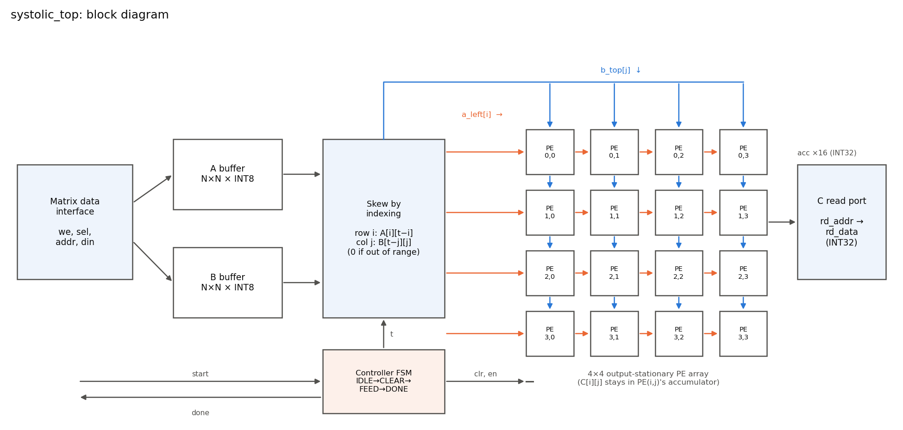
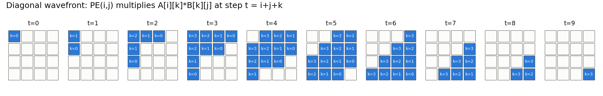
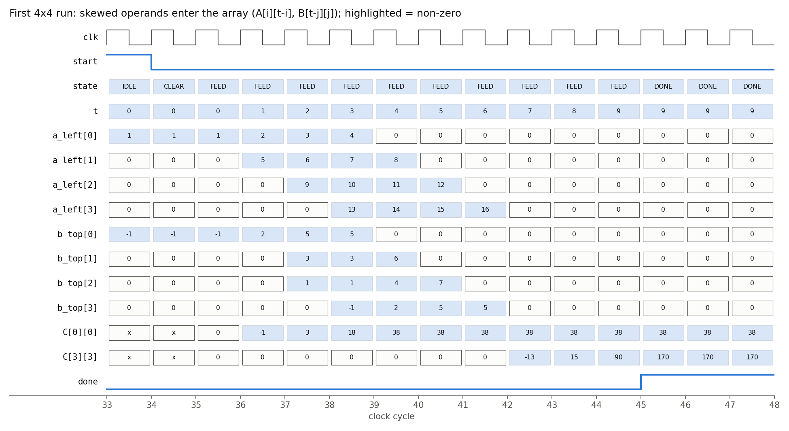
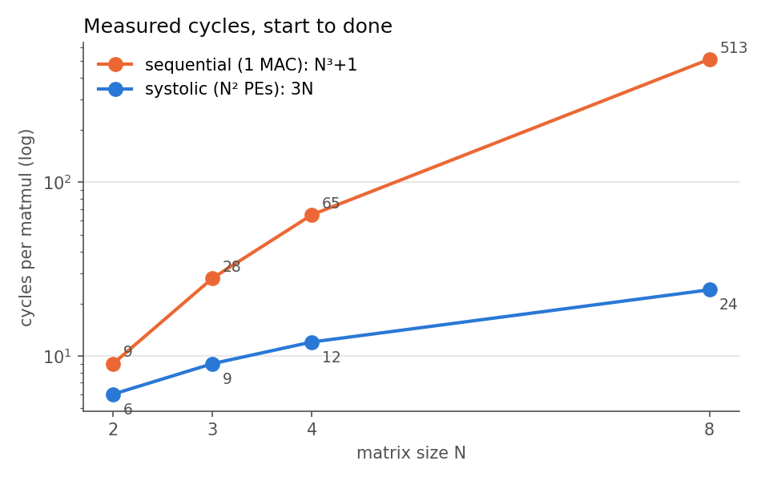
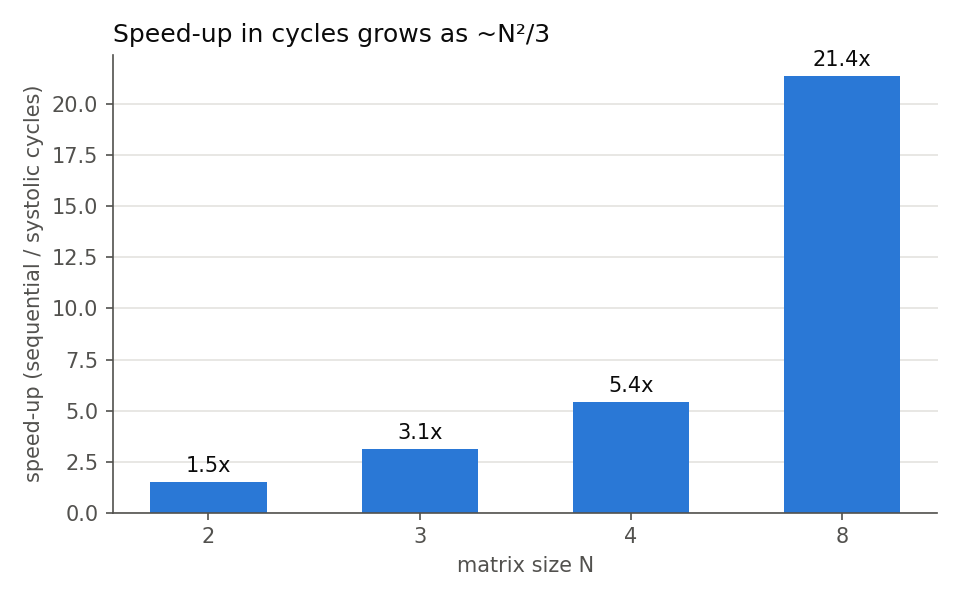
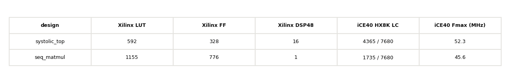

# Systolic Array Matrix Multiplication Accelerator (Project 12, Team ASCII)

A parameterised N×N output-stationary systolic array in synthesizable Verilog. It computes
`C = A × B` with signed INT8 inputs and 32-bit accumulators. The default is N = 4. A
single-MAC sequential design with the same interface serves as the baseline.

**Technical report (PDF):** [Systolic_Array_Report.pdf](https://raw.githubusercontent.com/abhijeetnst/MCA/main/docs/Systolic_Array_Report.pdf)



## Files

| File | Contents |
|---|---|
| `rtl/pe.v` | `mac` (combinational `acc + a*b`, signed 8×8→16, 32-bit add) and `pe` (registers `a_out`, `b_out`, `acc`; `clr`, `en`) |
| `rtl/systolic_array.v` | N×N `generate` grid of PEs. `a` moves right, `b` moves down, C[i][j] stays in PE(i,j) |
| `rtl/controller.v` | FSM `IDLE → CLEAR → FEED (t = 0..3N−3) → DONE`. Outputs `t`, `clr`, `en`, `done` |
| `rtl/systolic_top.v` | Matrix data interface, A/B input buffers, skew by indexing, C read port |
| `rtl/seq_matmul.v` | Sequential baseline: same ports, one `mac`, i/j/k counters, N³ cycles |
| `tb/tb_pe.v` | Exhaustive MAC check (all 65 536 INT8 pairs) plus directed PE tests |
| `tb/tb_systolic.v` | Matmul demo: 26 cases on both designs checked against a triple-loop reference, prints cycle counts |
| `syn/vivado.tcl` | Vivado batch flow for the lab PCs (Artix-7 xc7a35t, Basys3) |
| `scripts/plots.py` | Waveform, wavefront, cycle, speed-up and resource figures, block diagrams, numpy cross-check |
| `Makefile` | `lint sim-pe sim sweep synth pnr plots clean` (`make all` runs everything) |

## How it works

**Data interface** (identical on `systolic_top` and `seq_matmul`):
- write: `we=1`, `sel=0` for A or `sel=1` for B, `addr = row*N + col`, `din` = INT8 element
- run: pulse `start`, wait for `done`
- read: `rd_addr = row*N + col` → `rd_data` = C[row][col] (INT32)

**Dataflow.** The controller counts the systolic step `t`. At step `t`, row `i` receives
`A[i][t−i]` from the left and column `j` receives `B[t−j][j]` from the top, with 0 when the
index is out of range. The skew comes from indexing the buffers, so there are no shift
registers. Every PE passes `a` right and `b` down through one register, so `A[i][k]` and
`B[k][j]` meet in PE(i,j) at step `t = i + j + k`. The last product (i = j = k = N−1) arrives
at `t = 3N−3`, which gives a FEED phase of 3N−2 cycles.



**Controller FSM**

| State | Outputs | Next |
|---|---|---|
| IDLE | none | `start` → CLEAR |
| CLEAR | `clr=1`: zero every acc and a/b pipeline register | FEED with `t=0` |
| FEED | `en=1`: every PE does one MAC and passes a/b on | `t == 3N−3` → DONE, else `t+1` |
| DONE | `done=1`: results stay in the accumulators, readable via `rd_addr` | `start` → CLEAR |

Cycles from `start` to `done` = 1 (IDLE→CLEAR) + 1 (CLEAR) + 3N−2 (FEED) = **3N**.
The sequential baseline takes 1 + N³.



## Running

Tools: `iverilog`, `verilator`, `yosys`, `nextpnr-ice40`, `python3` with numpy and matplotlib.

```bash
make lint      # verilator --lint-only -Wall on systolic_top, seq_matmul, pe
make sim-pe    # PE + MAC testbench
make sim       # matmul demo, writes build/systolic.vcd
make sweep     # N = 2,3,4,8 -> build/sweep.csv
make synth pnr # yosys synth_xilinx stats + nextpnr-ice40 HX8K place & route
make plots     # docs/img/*.png (needs sim, sweep, synth, pnr first)
```

To view the waveform live, drop `build/systolic.vcd` into the Surfer web viewer
(app.surfer-project.org) or open it in GTKWave.

On a lab PC with Vivado (run from the repo root):

```bash
vivado -mode batch -source syn/vivado.tcl -tclargs systolic_top
```

## Results

### Verification
- `make lint`: no Verilator `-Wall` warnings. One local `lint_off` covers the unused right and bottom edge outputs of the array, and `pe.v` holds two modules on purpose.
- `make sim-pe`: exhaustive MAC (65 536 products, 0 mismatches), 16 directed PE checks and 200 random accumulate steps. Result: `ALL TESTS PASSED`. `make sim-pe` and `make sim` exit non-zero unless that line is printed.
- `make sim` (N=4): 26 cases on both designs (counting, identity, zero, all +127, all −128, mixed-sign extremes, 20 random). Result: `ALL TESTS PASSED (26 cases)`.
- `make sweep`: all 26 cases also pass for N = 2, 3, 4 and 8.
- `make plots` also checks the first VCD run independently: it reads A and B from the buffers, computes `A@B` in numpy and asserts the result equals the accumulators.
- Mutation check: moving the skew by one step makes 25 of the 26 cases fail (the all-zero case cannot fail on data). Ending FEED one cycle early fails all 26, because every case also checks the cycle count.

### Cycles (measured, `start` → `done`)

These are compute cycles only. Loading A and B takes 2N² write cycles on both designs (32 for N = 4), so end to end with loading, N = 4 is 44 vs 97 cycles (2.2×). Overlapping the next load with the current run would hide that cost.

| N | Systolic (3N) | Sequential (N³+1) | Speed-up (cycles) | Systolic MACs/cycle | Peak MACs/cycle (N²) |
|---|---|---|---|---|---|
| 2 | 6 | 9 | 1.5× | 1.33 | 4 |
| 3 | 9 | 28 | 3.1× | 3.00 | 9 |
| 4 | **12** | **65** | **5.4×** | 5.33 | 16 |
| 8 | 24 | 513 | 21.4× | 21.33 | 64 |

 

### FPGA resources and Fmax (N = 4)

| Design | Xilinx LUT | Xilinx FF | Xilinx DSP48E1 | iCE40 HX8K LC | iCE40 Fmax |
|---|---|---|---|---|---|
| `systolic_top` | 592 | 328 | 16 | 4365 / 7680 (56 %) | **52.3 MHz** |
| `seq_matmul` | 1155 | 776 | 1 | 1735 / 7680 (22 %) | **45.6 MHz** |

- The Xilinx columns are a Yosys `synth_xilinx` estimate for 7-series, not Vivado. The systolic FF count is low because Yosys packs every accumulator into the DSP48 `P` register (`PREG=1`) and most a/b pass registers into `AREG`/`BREG`. The sequential design keeps its 16×32-bit C buffer in fabric FFs, so it needs more LUTs and FFs despite having one multiplier.
- The iCE40 columns come from nextpnr-ice40 (`--hx8k --package ct256`, seed 1, 50 MHz target, pins auto-placed). The HX8K has no DSP blocks, so all 16 multipliers are built from LUTs. That is why the systolic design uses 2.5× the logic cells.
- At those clocks, one 4×4 matmul takes 12 / 52.3 MHz = **229 ns** on the systolic array and 65 / 45.6 MHz = **1424 ns** sequentially. That is a **6.2×** wall-clock speed-up. Effective throughput is 279 MMAC/s against 45 MMAC/s. The systolic peak is 16 MAC/cycle = 0.84 GMAC/s.
- `syn/vivado.tcl` gives real Artix-7 utilisation and timing at a 100 MHz constraint. It has not been run here because Vivado is not installed on this Mac.



## Design notes and limits
- The input buffers are plain register arrays, which is fine for small N. Move them to BRAM if N ≥ 16.
- One matmul runs at a time: loading the next A/B is not overlapped with FEED. Pipelining runs back to back would bring average throughput close to the N² peak.
- Writes while a run is busy are not blocked, and `start` is ignored while busy. The host must wait for `done`.
- N ≥ 2 (N = 1 gives a zero-width address). For N that is not a power of two, addresses ≥ N² are not guarded.
- Accumulators have no reset, only `clr` at `start`, so `rd_data` reads X in simulation before the first run. On an FPGA they power up as 0.
- 32-bit accumulators cannot overflow for INT8 inputs while N ≤ 131 071 (|product| ≤ 16 384).

## Team module ownership
| Member | Enrolment | Owns | Files |
|---|---|---|---|
| Abhijeet | 2401010013 | Systolic core: N×N array, controller FSM, top level (input buffers, skew, data interface) and integration | `rtl/systolic_array.v`, `rtl/controller.v`, `rtl/systolic_top.v` |
| Prashant Pandey | 2401010339 | Verification: matmul testbench, reference model, test cases, mutation tests, Makefile flow | `tb/tb_systolic.v`, `Makefile` |
| Shubham Jain | 2401010452 | Processing element and MAC unit, PE testbench | `rtl/pe.v`, `tb/tb_pe.v` |
| Divyanshi Khanka | 2401010159 | Sequential baseline and performance analysis (cycles, speed-up, sweep, charts) | `rtl/seq_matmul.v`, `scripts/plots.py` |
| Rahul Kumar | 2401020100 | Synthesis and FPGA results (Yosys, nextpnr, Vivado script, resources and Fmax) | `syn/vivado.tcl`, `synth` / `pnr` targets |
